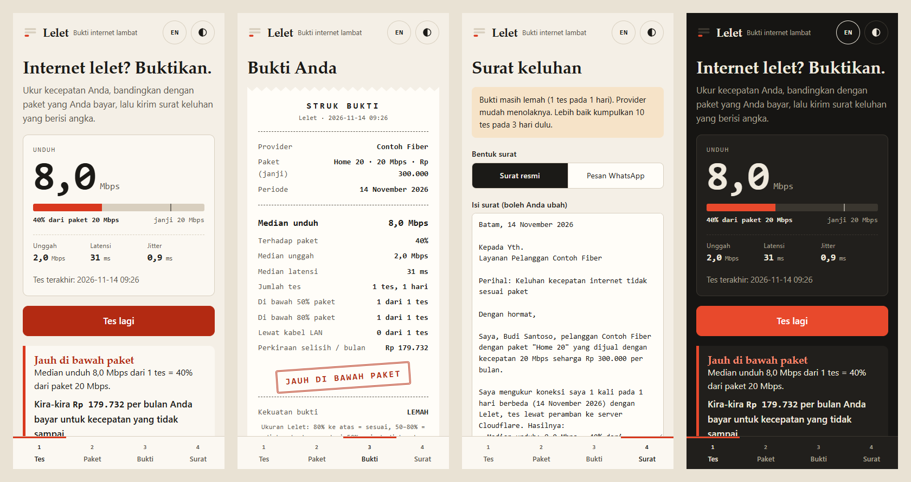

# Lelet

**Internet lelet? Buktikan.** Ukur kecepatan internet Anda, bandingkan dengan paket yang Anda bayar, dan dapatkan
surat keluhan siap kirim yang berisi angka. Gratis, tanpa akun, data tetap di perangkat Anda.

*Slow internet? Prove it. Measure your speed, compare it with the plan you pay for, and get a ready-to-send
complaint letter with the numbers in it. Free, no account, your data stays on your device.*

**Buka / open: https://juw12.github.io/lelet/**



*Screens from the automated browser test: a simulated 8 / 2 Mbps line against a 20 Mbps plan. "Contoh Fiber" and "Budi Santoso" are made up.*

## Mengapa ini ada / Why this exists

A speed test tells you a number. It does not tell you whether that number is what you paid for, and one test is
easy for a provider to wave away. Lelet keeps every test, compares the median with your plan, shows how strong your
case is, and writes the complaint for you.

## Cara pakai / How to use

1. **Tes** - press the start button. A "Hemat" test takes under 20 seconds and at most about 13 MB of data (6.8 MB on an 8 / 2 Mbps line).
2. **Paket** - type the speed your provider sold you (Mbps) and what you pay per month.
3. **Bukti** - repeat on different days and at different hours. The checklist shows what a strong case still needs:
   10 tests, 3 days, 3 tests at peak hours (18.00-22.59) and 3 outside them.
4. **Surat** - copy the formal letter, or the short WhatsApp version, and send it to your provider's customer
   service. Print or save as PDF from the same page.
5. **After sending** - under the letter, enter the date you sent it and the ticket number, then press
   "Tandai terkirim". Lelet counts the 7 working days the letter gives the provider and shows the deadline.
6. **No fix by the deadline?** - open "Surat kedua". It is addressed to the complaint service of the Ministry of
   Communication and Digital Affairs (Komdigi), with a copy to the provider, and carries the date of your first
   letter, your ticket number and your numbers. The app lists the channels: call centre 159 and lapor.go.id
   (SP4N-LAPOR!), as named on komdigi.go.id pages read on 2026-11-14. Check them again before you send.

Not sure yet? Press "Lihat contoh" to load sample data (always marked as a sample) and see the receipt and the letter.

## How it measures

- Download: 3 parallel streams from `https://speed.cloudflare.com/__down`. The first part of the transfer (TCP
  ramp-up, up to 1 second) is left out, and the rest is averaged.
- Upload: one POST to `https://speed.cloudflare.com/__up`.
- Latency: the median of 10 small requests (the first one, which pays for DNS and TLS, is thrown away); jitter is the
  mean change between neighbours.
- A reading is marked "low confidence" when the steady window is shorter than 1.5 seconds or the transfer stalled.

| Mode   | Download budget | Upload budget | Time limit (down / up) |
|--------|-----------------|---------------|------------------------|
| Hemat  | 10 MB           | 3 MB          | 6 s / 4 s              |
| Normal | 45 MB           | 15 MB         | 8 s / 6 s              |
| Penuh  | 180 MB          | 60 MB         | 10 s / 8 s             |

The budgets are upper limits; a slow line stops at the time limit and uses less.

**Hemat is for slow lines and small data quotas.** On a fast line its 10 MB budget is used up before the reading
settles, so the app marks the result "less certain" and suggests Normal. For plans of 50 Mbps and above, start with
Normal; use Penuh for the fastest plans.

## The yardstick

Lelet's own rule, stated in the app and in the letter. **It is not a legal threshold.**

- 80% of the plan speed or more: matches the plan.
- 50% to under 80%: below the plan.
- Under 50%: far below the plan.

The rupiah figure is `price x (1 - median download / plan speed)`: an estimate of what you paid for and did not get.
It is labelled as an estimate everywhere it appears.

## Limits (please read)

- This is **not an official measurement** and **not legal advice**. It is your own evidence, a starting point.
- A browser test measures the whole path: your device, your Wi-Fi, your router and the provider. Test over a LAN
  cable when you can; the letter says how many tests were wired.
- Most home plans are sold as "up to" a speed. A provider can point to that wording. Many tests across several days
  and hours are what make the pattern hard to dismiss.
- The letter cites Law No. 8 of 1999 on Consumer Protection (Article 4 letters c, d and h, Article 7 letter g,
  Article 19 paragraph (1)). The wording of both letters (the first and the second) has not been reviewed by a
  lawyer.
- The 7 working days are the deadline the letter itself sets, not a period fixed by law. Lelet counts Monday to
  Friday, starting the day after you sent the letter. It does not know public holidays, so the real deadline can be
  later than the date shown.
- Lelet does not send anything for you and cannot see whether the provider answered. "Sent" is what you tell it.
- The test uses Cloudflare's public speed-test endpoints. They are not a documented public API and carry no
  service promise. If Cloudflare limits or changes them, the app shows "server busy" and the test must point at
  another server (`DEFAULT_BASE` in `engine.js`; any server that implements `/__down` and `/__up` works).

## Privacy

- No account, no backend, no analytics, no cookies, no third-party scripts or fonts.
- Tests, your plan, and the sent date and ticket number of your letter are kept in your browser's `localStorage`
  only. Export (JSON or CSV) and delete are in the app.
- The only network traffic is the test itself, to Cloudflare, which sees your IP address like any site you visit.
- A Content-Security-Policy in `index.html` blocks every other destination.

## Run it yourself

No build step and no dependencies. Any static file server works:

```
python -m http.server 8080
```

Then open `http://localhost:8080/`. On `localhost` you can point the app at a test server with
`?server=http://127.0.0.1:8765`.

## Tests

```
npm test             # 19 unit tests of the logic (node --test, no packages needed)
npm run accuracy     # engine against a rate-limited local server
npm run e2e          # 71 browser checks (Python + Playwright)
python tests/live_check.py   # one real test on the published page
```

Results on 2026-11-14 (Windows 11, Node 26, Edge 157):

| Check | Result |
|---|---|
| Unit tests | 19 of 19 pass |
| Accuracy, 8 / 2 Mbps line, Hemat | read 8.01 / 2.00 Mbps |
| Accuracy, 30 / 10 Mbps line, Normal | read 30.00 / 9.87 Mbps |
| Browser e2e, 8 / 2 Mbps line | 71 of 71 checks pass, read 8.00 / 1.99 Mbps, 6.8 MB used |
| Published page, real Hemat test | 8 of 8 checks pass: 3.5 s, 11.2 MB, no console or CSP errors |

Honest notes on the tests:

- The accuracy and e2e speed readings must land within 10% of the simulated line. Each reading may be retried up
  to 3 times, because a busy PC can stall the local test server; every attempt is printed. On the run above both
  passed on the first attempt.
- The simulated line is a token bucket on localhost. It checks the arithmetic of the engine, not real-world radio,
  Wi-Fi or peering.
- `tests/e2e.py` uses Playwright's Chromium when present and falls back to an installed Edge or Chrome.
- The published-page check ran on an office line of unknown true speed (it read 68.7 / 28.8 Mbps and, as
  designed for a fast line in Hemat mode, marked the result "less certain"). It shows the page works end to
  end; it says nothing about accuracy.

## Files

| File | What it does |
|---|---|
| `index.html`, `styles.css`, `theme.js` | page shell, look, light and dark |
| `app.js` | screens: Tes, Paket, Bukti, Surat |
| `engine.js` | the measurement (browser and Node) |
| `core.js` | pure logic: summary, verdict, case strength, both letters, working-day count, import and export |
| `i18n.js` | Indonesian and English text |
| `sw.js`, `manifest.webmanifest`, `icons/` | install to home screen, open offline |
| `tests/` | unit tests, fake rate-limited server, accuracy check, browser e2e |
| `design.md` | design rules for this app |

## Roadmap

Lelet is the first rung of a ladder. Each rung only starts when the one below has real users.

1. **Now:** proof, a complaint letter, a deadline count and a second letter for one person. Free.
2. **Next:** opt-in, anonymous sharing of results, to build an honest map of delivered-versus-sold speed per
   provider and area. Nothing is shared today.
3. **Then:** switching advice based on that map ("in your area, this provider delivers more of what it sells").
4. **Later, only if the data proves demand:** a virtual operator that buys capacity wholesale and sells it with a
   delivered-speed guarantee.

## License

MIT, see `LICENSE`. Not affiliated with any internet provider, with Cloudflare, or with any government body.
